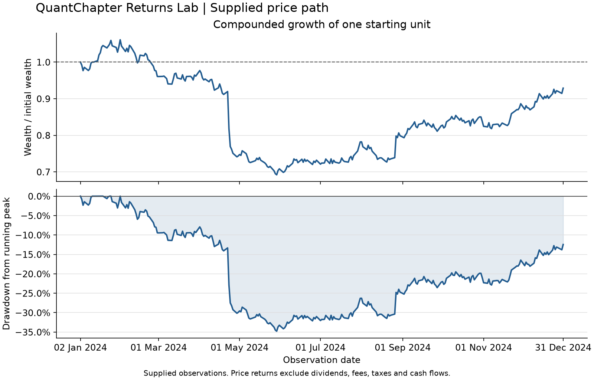

# QuantChapter Returns Lab

Reproducible financial data analysis with Python. Clear mathematics, tested
implementations, and worked examples from QuantChapter.

A small educational library for answering a concrete question: **how did a
positive price series grow, fluctuate, and fall from earlier peaks?**

The calculation package has **no runtime dependencies**, network calls, accounts,
or API keys. Python 3.11–3.14 is supported. Plotting and notebooks are optional.
This is an initial educational release, not a trading system or a forecast.

## Start with a four-price example

From a cloned checkout, create an isolated environment and install the package:

```shell
python -m venv .venv
# Activate .venv using the command for your shell, then:
python -m pip install .
```

On PowerShell, activate with `.venv\Scripts\Activate.ps1`. On macOS/Linux,
use `source .venv/bin/activate`. Alternatively, use the environment's Python
executable directly if shell activation is restricted.

```python
from quantchapter_returns import (
    cumulative_growth,
    maximum_drawdown,
    simple_returns,
    total_return,
)

prices = [100.0, 110.0, 99.0, 118.8]
returns = simple_returns(prices)
print([round(value, 4) for value in returns])  # [0.1, -0.1, 0.2]
print(round(total_return(prices), 4))  # 0.188
print(round(maximum_drawdown(prices), 4))  # -0.1
print([round(value, 4) for value in cumulative_growth(returns)])
# [1.0, 1.1, 0.99, 1.188]
```

The 10% gain and 10% loss do not cancel: the loss applies to 110, leaving 99.
The later 20% gain takes 99 to 118.8. The total price return is 18.8%; the worst
observed fall from a previous peak is 10%. The API represents both as decimal
fractions, with drawdowns signed nonpositive.

## Run a complete analysis

```shell
quantchapter-returns report data/synthetic_prices.csv
quantchapter-returns report data/synthetic_prices.csv --output artifacts/report.json
```

The command validates the CSV, computes statistics, and emits versioned JSON
with an exact input SHA-256 digest and the calculation conventions. It refuses
to overwrite files unless `--force` is supplied. An invalid input leaves prior
output intact. `python -m quantchapter_returns` offers the same command.

For the explanatory plot, install the optional plotting dependencies:

```shell
python -m pip install ".[plot]"
python examples/plot_report.py
```



The figure describes the supplied synthetic observations. Its engineered shocks
are teaching examples, not observed investment performance. See the [data
provenance](data/README.md) and [generator manifest](data/provenance.json).

## Learn the calculations

1. [Prices, returns and growth](notebooks/01_prices_returns_growth.ipynb)
   develops relative change, compounding and logarithmic returns through a
   worked path and fresh checked comparisons.
2. [Drawdown and volatility](notebooks/02_drawdown_and_volatility.ipynb)
   separates loss from a peak from fluctuation between observations, then
   explains sample standard deviation and the assumptions behind annualization.

Both notebooks include saved executed output. To rerun them, install
`python -m pip install ".[notebooks]"` and use Jupyter, or follow the locked
[development workflow](CONTRIBUTING.md). No market-data download is required.

Read the [learning guide](docs/learning-guide.md), [mathematical conventions](docs/mathematics.md)
and [API reference](docs/api.md) for preparation, worked reasoning and contracts.

## What is included

| Capability | Contract |
| --- | --- |
| Simple/logarithmic returns | Positive finite prices; chronological input |
| Compounded growth | Positive initial wealth; simple returns greater than −1 |
| Total price return | Last-to-first change; no cash-flow adjustments |
| Volatility | Sample or population standard deviation; explicit frequency |
| Drawdown | Signed distance from running observed peak |
| CSV/report command | Strict dates/schema, bounded input, deterministic JSON |

No silent sorting, missing-value filling, or price adjustment occurs. Prices
exclude dividends, fees, taxes and external cash flows. Annualization uses a
caller-supplied frequency; irregular dates are accepted but do not establish
that square-root-of-time scaling is appropriate. Financial interpretation of
those assumptions remains the reader's responsibility.

## Engineering and verification

The repository includes independent exact/Decimal reference calculations,
property-based tests, strict type checking, branch-coverage enforcement,
executed tutorials, clean-wheel installation checks and a deterministic fixture
rebuild. GitHub workflows test the declared Python/OS matrix. Dependencies are
locked for development, workflow actions are pinned, and security updates have
a documented review path.

See [contribution instructions](CONTRIBUTING.md), [release verification](docs/release-process.md),
[security reporting](SECURITY.md), and the [changelog](CHANGELOG.md). Passing
software checks does not establish learner effectiveness or investment suitability.

## About QuantChapter

QuantChapter is being built as a quantitative education platform spanning
mathematics, statistics, programming, finance and research. Returns Lab is a free,
public companion project showing how mathematical reasoning connects to reliable
Python code. The platform's authored material remains unpiloted; paid checkout
is currently closed. This repository does not offer a subscription or payment flow.

Project questions: [open an issue](https://github.com/QuantChapter/quantchapter-returns-lab/issues).
Business and private security contact: [support@quantchapter.com](mailto:support@quantchapter.com).

Original code, tutorials and synthetic data are available under the [MIT license](LICENSE).
